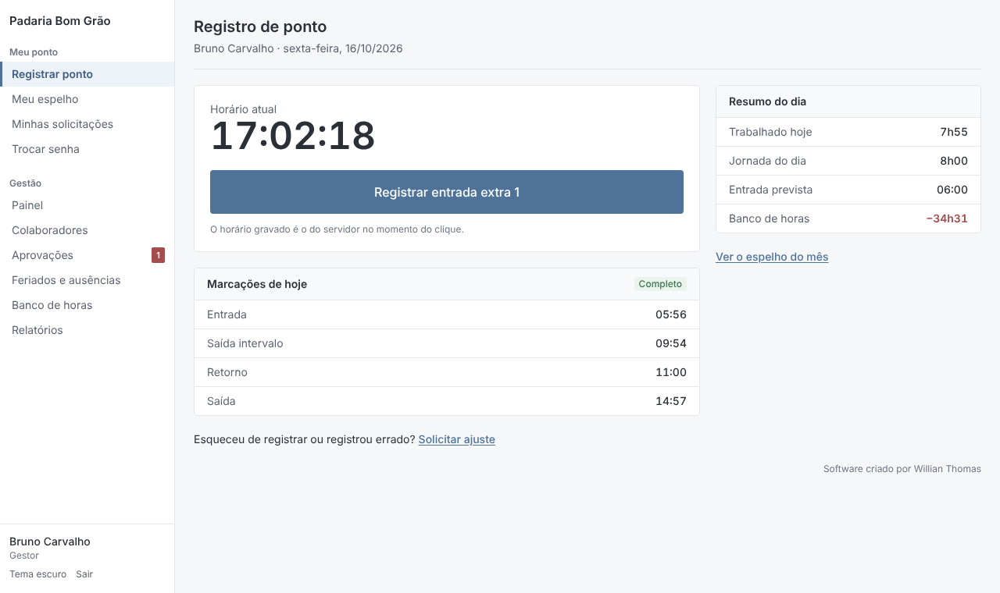
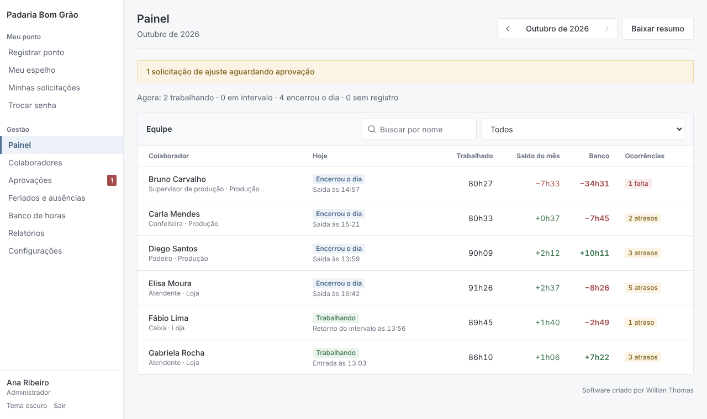
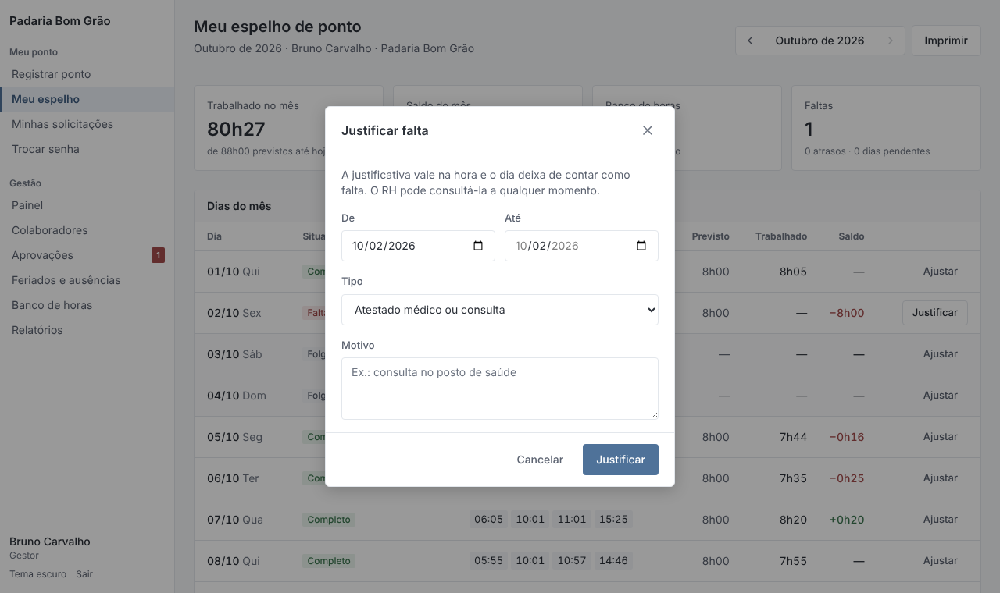
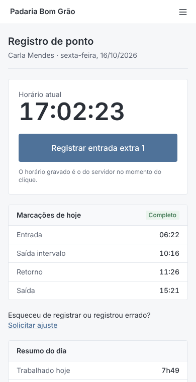

# Controle de Ponto

Sistema web gratuito para registro de ponto, espelho mensal e banco de horas. Funciona sozinho, sem planilha no Google Drive: basta abrir o link, entrar com usuário e senha e registrar. Foi pensado para ser simples de usar por qualquer pessoa, no computador ou no celular, com visual limpo, cores suaves e tema claro ou escuro.

**Software criado por Willian Thomas.**

> A versão anterior, em Google Apps Script e Planilhas, está preservada em [`legacy/`](legacy/). Os cadastros e marcações dela podem ser importados (veja [Migrar da versão em planilha](#migrar-da-versão-em-planilha)).

## Telas

| Registro de ponto | Painel do RH |
| --- | --- |
|  |  |

| Justificativa de falta | No celular |
| --- | --- |
|  |  |

As telas acima usam os dados de demonstração (veja [Executar no seu computador](#executar-no-seu-computador)).

## O que o sistema faz

### Para o colaborador

- Registro de ponto com um botão que diz a ação ("Registrar entrada", "Registrar saída"), usando o relógio do servidor e com proteção contra clique duplo.
- Marcações do dia, horas trabalhadas, jornada prevista e saldo do banco de horas.
- Espelho de ponto mensal com marcações, previsto, trabalhado e saldo de cada dia.
- Solicitação de ajuste: incluir um horário esquecido ou desconsiderar uma marcação errada, com motivo.
- **Justificativa de falta sem depender do RH:** no espelho, o próprio colaborador justifica a falta (atestado, consulta, motivo pessoal, folga combinada ou licença). O dia é abonado na hora; o RH vê todas as justificativas em *Feriados e ausências* e pode removê-las.
- Acompanhamento das solicitações (pendente, aprovada, recusada) e impressão do próprio espelho.
- Pode ser adicionado à tela inicial do celular como um aplicativo, com tema claro e escuro.

### Para o RH e os gestores

- **Painel:** quem está trabalhando agora e, para cada pessoa, horas do mês, saldo, banco de horas, faltas e atrasos.
- **Colaboradores:** cadastro completo (cargo, departamento, matrícula, perfil de acesso), senha temporária gerada pelo sistema, desligamento e reativação.
- **Jornadas por vigência:** horas previstas por dia da semana, entrada prevista e intervalo. Uma nova jornada vale a partir da data escolhida e não altera o cálculo do passado.
- **Aprovações:** fila de ajustes solicitados, com aprovação ou recusa e observação.
- **Correção direta:** incluir ou desconsiderar marcações de qualquer dia, sempre com motivo.
- **Feriados:** importação automática dos feriados nacionais (incluindo Sexta-feira Santa) e cadastro dos estaduais e municipais.
- **Ausências:** férias, atestados, licenças, abonos e folgas não geram falta; a compensação desconta do banco.
- **Banco de horas:** saldo inicial, pagamento de extras, descontos e correções lançados como movimentações.
- **Relatórios:** resumo mensal e espelho de ponto em CSV (abre direto no Excel) e espelho para impressão/PDF com campos de assinatura.
- **Configurações:** nome da empresa, fuso horário, tolerâncias e aprovação automática de ajustes.

### Perfis de acesso

| Perfil | Pode |
| --- | --- |
| Colaborador | Registrar ponto, ver o próprio espelho, justificar faltas e solicitar ajustes de horário. |
| Gestor | Tudo do colaborador, mais painel, espelhos da equipe, aprovações, correções de marcação, ausências e relatórios. |
| Administrador | Tudo do gestor, mais cadastros, jornadas, feriados, banco de horas e configurações. |

Pode haver vários gestores e administradores. O sistema impede remover o último administrador ativo.

## Regras de apuração

| Indicador | Regra |
| --- | --- |
| Horas trabalhadas | Soma dos pares de marcações (entrada → saída, retorno → saída...). Aceita qualquer número de pares no dia. |
| Dia completo | Número par de marcações. Número ímpar em dia passado fica **pendente** e não gera saldo até ser corrigido. |
| Saldo do dia | Trabalhado − previsto. Variações até a **tolerância diária** (padrão 10 min, CLT art. 58 §1º) não geram saldo. |
| Falta | Dia útil passado, dentro do período de apuração, sem marcações, sem feriado, sem ausência e sem justificativa. Debita a jornada do dia. |
| Falta justificada | Justificada pelo colaborador ou registrada pelo RH: não debita o banco de horas. Ajustes de horário continuam passando pela aprovação do RH. |
| Atraso | Primeira marcação depois da entrada prevista, acima da tolerância de atraso (padrão 5 min). |
| Feriado e folga | Não geram débito; trabalho nesses dias vira crédito. |
| Banco acumulado | Saldo inicial + saldos diários desde o início da apuração + movimentações lançadas, até o fim do mês consultado ou hoje. |

Alertas exibidos no espelho e no painel: intervalo menor que 1 hora em jornada acima de 6 horas, jornada acima de 10 horas, descanso menor que 11 horas entre um dia e outro e marcação ímpar.

O sistema apura horas; não calcula valores de folha de pagamento. Turnos que atravessam a meia-noite ainda não são contemplados: as marcações depois da meia-noite caem no dia seguinte.

## Tecnologia

| Parte | Tecnologia |
| --- | --- |
| Servidor | Node.js 22, Express 5, TypeScript, validação com Zod |
| Banco de dados | PostgreSQL (produção) ou PostgreSQL embutido via PGlite (testes, demonstração e instalações pequenas) |
| Interface | React 19, React Router, Tailwind CSS 4, ícones Lucide |
| Testes | Vitest e Supertest, executados nos dois bancos |

Segurança: senhas com scrypt e salt individual, sessão em cookie `HttpOnly`/`SameSite`, bloqueio após 5 tentativas de login em 15 minutos, permissões verificadas no servidor em toda requisição, API que aceita apenas JSON e proteção contra fórmulas em arquivos CSV.

## Executar no seu computador

Pré-requisito: [Node.js 22](https://nodejs.org).

```bash
npm install
npm run build
npm start
```

Abra <http://localhost:3000>. Na primeira visita o sistema pede o nome da empresa, o fuso horário e cria a conta de administrador. Sem `DATABASE_URL`, os dados ficam na pasta `data/`.

Para ver o sistema já preenchido com uma empresa fictícia:

```bash
DATA_DIR=./data-demo npm run demo -w server
DATA_DIR=./data-demo npm start
```

Entre com usuário `admin` e senha `demo1234`.

Para desenvolver com recarga automática, rode `npm run dev:server` e `npm run dev:web` em dois terminais e abra <http://localhost:5173>.

## Colocar no ar

O sistema é um único serviço Node.js e precisa de um PostgreSQL. Configure a variável `DATABASE_URL` com o endereço do banco; as tabelas são criadas automaticamente na primeira inicialização.

### Hospedagem gratuita: Render + Neon

1. Crie um banco gratuito em [neon.tech](https://neon.tech) e copie a *connection string* (`postgres://...?sslmode=require`).
2. Em [render.com](https://render.com), escolha **New → Blueprint** e selecione este repositório. O arquivo `render.yaml` já define o serviço.
3. Quando solicitado, cole a connection string em `DATABASE_URL`.
4. Ao terminar a implantação, abra o endereço gerado e faça a configuração inicial.

Os dois serviços têm plano gratuito. No Render gratuito o sistema "dorme" depois de uns 15 minutos sem acesso; o primeiro acesso seguinte pode levar até um minuto para abrir, e depois funciona normalmente. As marcações usam o horário do servidor no momento do clique, então essa espera não altera o horário registrado.

### Variáveis de ambiente

| Variável | Padrão | Uso |
| --- | --- | --- |
| `DATABASE_URL` | — | PostgreSQL. Vazio usa o banco embutido em `DATA_DIR`. |
| `DATA_DIR` | `./data` | Pasta do banco embutido. |
| `PORT` | `3000` | Porta HTTP. |
| `SESSION_HOURS` | `12` | Duração da sessão. |
| `NODE_ENV` | — | Use `production` em produção (ativa cookies seguros, que exigem HTTPS). |
| `TRUST_PROXY` | ativo | Use `0` se o serviço não estiver atrás de um proxy. |
| `INSECURE_COOKIES` | — | Use `1` apenas para testar em produção sem HTTPS (por exemplo, pelo IP da rede local). |

O banco embutido é prático para testar ou para uma única loja num servidor próprio, mas não roda em hospedagens com disco temporário (como o plano gratuito do Render). Nesses casos, use PostgreSQL.

## Migrar da versão em planilha

1. Na planilha antiga, escolha **Arquivo → Fazer download → Microsoft Excel (.xlsx)**.
2. Com `DATABASE_URL` (ou `DATA_DIR`) apontando para o banco novo, execute:

   ```bash
   npm run importar-planilha -- caminho/Controle_de_Ponto.xlsx
   ```

3. O script importa os colaboradores (com jornada, data de início, saldo inicial e situação), os PINs atuais e as marcações aprovadas. A conta de RH vira **Administrador**.

Cada pessoa entra com o mesmo nome e PIN de antes e define uma senha pessoal no primeiro acesso. O script pode ser executado mais de uma vez: o que já foi importado é ignorado. Com o banco embutido, pare o servidor antes de importar.

## Estrutura do projeto

```
server/            API, regras de apuração e banco de dados
  src/domain/      cálculo da jornada, fuso horário e feriados (funções puras)
  src/routes/      rotas da API (autenticação, colaborador, gestão)
  src/services/    acesso aos dados e regras compartilhadas
  src/scripts/     importação da planilha e dados de demonstração
  test/            testes de cálculo e da API
web/               interface React
docs/telas/        capturas de tela usadas neste README
legacy/            versão 1 em Google Apps Script
```

## Testes

```bash
npm test                                             # banco embutido
TEST_DATABASE_URL=postgres://... npm test            # PostgreSQL real (o banco é apagado)
```

O GitHub Actions roda a verificação de tipos, os testes nos dois bancos e o build a cada envio.

## Autor

**Willian Thomas** — desenvolvimento do Controle de Ponto.
